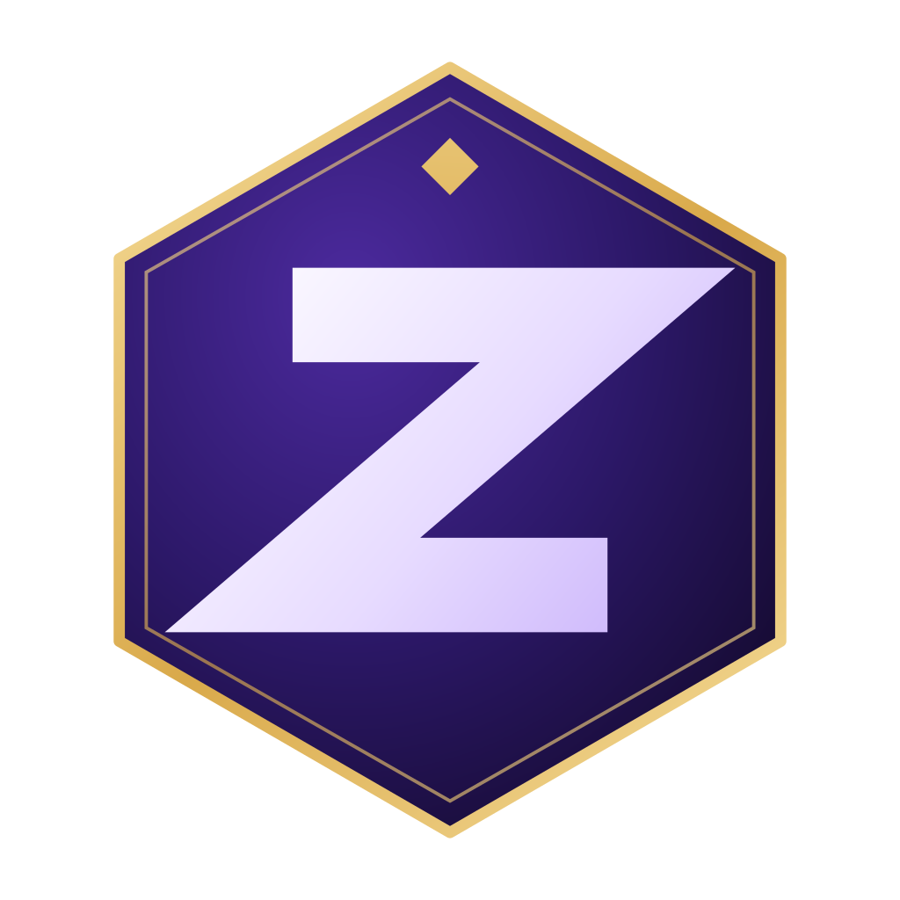

<div align="center">



# BadutZY Studio

**Official Website of BadutZY Studio - A Solo Indie Game Development Studio**

[]()
[]()
[]()
[]()
[]()
[]()

[Visit Website](https://badutzy-studio.vercel.app) &nbsp;|&nbsp; [About](#about) &nbsp;|&nbsp; [Features](#core-features) &nbsp;|&nbsp; [Getting Started](#getting-started)

</div>

---

## Table of Contents

- [About](#about)
- [Getting Started](#getting-started)
- [Available Scripts](#available-scripts)
- [Project Structure](#project-structure)
- [Site Sections](#site-sections)
- [Core Features](#core-features)
- [Adding a New Game Entry](#adding-a-new-game-entry)
- [Technology Stack](#technology-stack)
- [Deployment](#deployment)
- [Roadmap](#roadmap)
- [Contact](#contact)
- [License](#license)

---

## About

BadutZY Studio is the official portfolio and landing website for BadutZY Studio, a solo indie game development studio where every stage of the process, concept, design, programming, art direction, and release, is handled by a single developer.

The website introduces the studio, its vision and mission, its current game catalogue, its development pipeline, the tools used to build each project, and the founder behind it. It is built as a fast, animated, single-page experience that works cleanly across desktop and mobile devices.

---

## Getting Started

### Prerequisites

- Node.js v18 or newer
- npm (or another compatible package manager such as pnpm or yarn)

### Installation

```bash
# Clone the repository
git clone <repository-url>
cd badutzy-studio-website

# Install dependencies
npm install
```

### Running the Development Server

```bash
npm run dev
```

The site will be available at [http://localhost:5173](http://localhost:5173).

### Building for Production

```bash
npm run build
npm run preview   # preview the production build locally
```

---

## Available Scripts

| Script | Description |
|---|---|
| `npm run dev` | Starts the Vite development server with hot module reload |
| `npm run build` | Type-checks the project and builds it for production |
| `npm run preview` | Serves the production build locally for final review |
| `npm run lint` | Runs ESLint across the project |
| `npm run format` | Formats the codebase with Prettier |

---

## Project Structure

```
badutzy-studio-website/
├── public/
│   ├── badutzy-logo.png
│   ├── badutzy-studio.png
│   ├── BadutZY.png
│   └── games/                    # Cover images for individual game entries
│
├── src/
│   ├── App.tsx                   # Root component, composes all page sections
│   ├── main.tsx                  # Application entry point
│   ├── styles.css                # Global styles and theme tokens
│   │
│   ├── components/
│   │   ├── site/
│   │   │   ├── hero.tsx          # Hero section with animated intro
│   │   │   ├── nav.tsx           # Site navigation bar
│   │   │   ├── primitives.tsx    # Shared motion and layout primitives
│   │   │   ├── scroll-progress.tsx # Scroll progress indicator
│   │   │   └── sections.tsx      # About, Vision, Games, Process, Tech Stack, Founder, Footer
│   │   └── ui/                   # shadcn/ui component library
│   │
│   ├── data/
│   │   └── games.ts              # Single source of truth for the game catalogue
│   │
│   ├── hooks/
│   │   └── use-mobile.tsx        # Hook for detecting mobile viewports
│   │
│   └── lib/
│       └── utils.ts              # Utility functions
│
├── index.html
├── vite.config.ts
├── vercel.json
├── components.json                # shadcn/ui configuration
├── eslint.config.js
├── package.json
└── tsconfig.json
```

---

## Site Sections

The website is a single-page application composed of the following sections, in order.

| Section | Description |
|---|---|
| Hero | Studio introduction, tagline, and key highlights |
| About | Overview of what BadutZY Studio is and how it operates |
| Vision and Mission | The studio's long-term direction and guiding principles |
| Games | Catalogue of current and upcoming game projects |
| Process | The five-stage solo development pipeline, from concept to release |
| Tech Stack | Tools and technologies used across the studio's Unity and Java toolchains |
| Founder | Profile of BadutZY, the studio's founder and sole developer |
| Footer | Studio branding and links to official social and community channels |

---

## Core Features

| Feature | Description |
|---|---|
| Single-Page Layout | Smooth-scrolling, section-based layout with an active-link navigation bar |
| Animated Interface | Motion-driven transitions, reveals, and hover interactions throughout the page |
| Game Catalogue | Structured game entries with cover images, status badges, and a detailed view modal |
| Interactive Tech Stack | Toggleable display of tools grouped by toolchain, with contextual descriptions |
| Responsive Design | Fully adapted layout for desktop, tablet, and mobile screen sizes |
| Theming | Consistent dark theme with a defined color and typography system |
| Social Integration | Direct links to the studio's and founder's official social and developer profiles |

---

## Adding a New Game Entry

Game entries are managed from a single file, so new projects can be added without touching any component code.

1. Open `src/data/games.ts`.
2. Add a new object to the `games` array with a title, status, tagline, blurb, summary, and metadata fields.
3. Optionally add a cover image to `public/games/` and reference it with a leading slash, for example `/games/my-project.png`.
4. Optionally add a `link` field to show a "Visit Project" button once the project has somewhere to link to.

Both the Games section on the page and its detail modal read directly from this file.

---

## Technology Stack

| Layer | Technology | Purpose |
|---|---|---|
| Framework | React 19 + TypeScript | Component-based user interface and application logic |
| Build Tool | Vite | Development server and production bundling |
| Styling | Tailwind CSS 4 | Utility-first styling and design tokens |
| UI Components | shadcn/ui + Radix UI | Accessible, composable interface primitives |
| Animation | Motion (Framer Motion) | Scroll-based, hover, and transition animations |
| Forms and Validation | React Hook Form + Zod | Form state management and schema validation |
| Icons | Lucide React | Icon set used throughout the interface |
| Linting and Formatting | ESLint + Prettier | Code quality and consistent formatting |
| Hosting and Deployment | Vercel | Continuous deployment and global content delivery |

---

## Deployment

The project is configured for deployment on Vercel. The included `vercel.json` rewrites all routes to `index.html`, which keeps the single-page application working correctly on refresh and direct navigation.

1. Push the repository to GitHub.
2. Import the project into [Vercel](https://vercel.com).
3. Deploy. No additional environment variables are required for a standard deployment.
4. Every push to the main branch triggers an automatic redeployment.

---

## Roadmap

The following areas are being considered for future development. This list reflects general direction rather than a fixed release schedule.

- Additional game entries as new projects reach a showable stage
- Expanded project detail pages for released titles
- Further refinement of animations and accessibility across the site
- Official studio domain, replacing the current Vercel subdomain

---

## Contact

BadutZY Studio and its founder can be reached through the official channels listed on the website's Founder and Footer sections, including GitHub, Instagram, YouTube, and X.

---

## License

This project and all associated branding, assets, and game information belong to BadutZY Studio. All rights reserved.

---

<div align="center">

**Built alone, made with dedication - BadutZY Studio**

[Back to Top](#badutzy-studio)

</div>